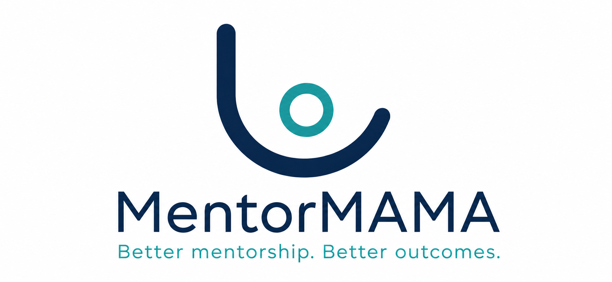

  
  
<strong>Stronger mentorship for safer midwifery clinical placements.</strong>

---

## About MentorMAMA

MentorMAMA supports consistent, supportive mentorship for midwifery students during clinical placement. It brings students, clinical mentors, ward teams, and university coordinators together around orientation, learning, placement support, and feedback.

The project is being developed with JKUAT School of Nursing, JHUB Africa, and AfyaVentures.

## Who it supports

- **Students** prepare for placement, understand expectations, and share feedback about their learning experience.
- **Clinical mentors** support student induction, learning, and placement progress.
- **Nurse Managers and ward teams** coordinate mentorship and follow up on placement concerns.
- **University coordinators** support cohorts and review programme progress.
- **Programme administrators** manage programme access and setup.

MentorMAMA is an educational and mentorship platform. It is not a clinical record system and is not intended to collect patient-identifying information.

## Project documentation

Browse the [documentation guide](docs/README.md) to find product requirements, architecture decisions, user journeys, engineering guidance, verification records, and operations documentation.

For contributor onboarding and local development, see [Contributing to MentorMAMA](docs/onboarding/CONTRIBUTING.md). Production deployment guidance is in the [managed VPS runbook](docs/operations/managed-vps-runbook.md).

## License and confidentiality

This repository contains proprietary project materials, designs, and source code. All rights are reserved by the collaborative project partners. Unauthorized copying, distribution, or adaptation is prohibited.
